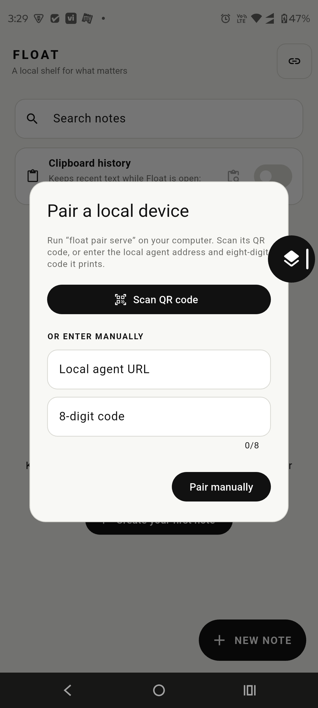
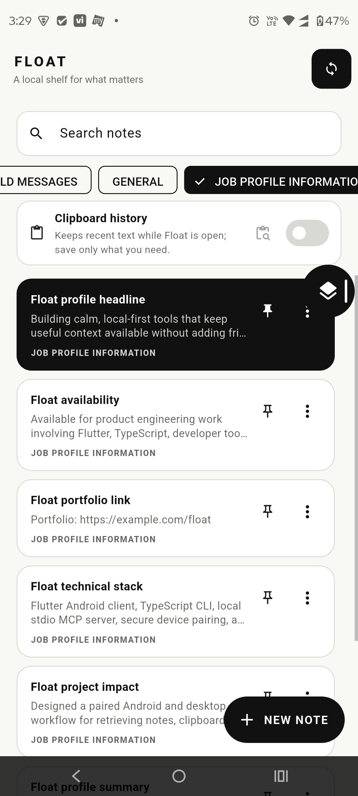
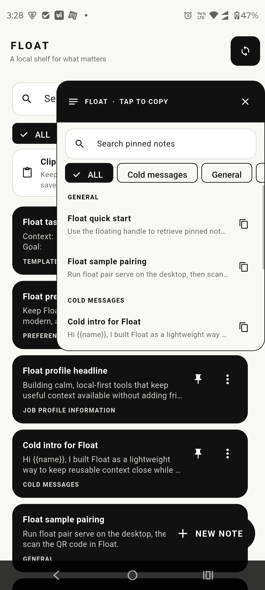
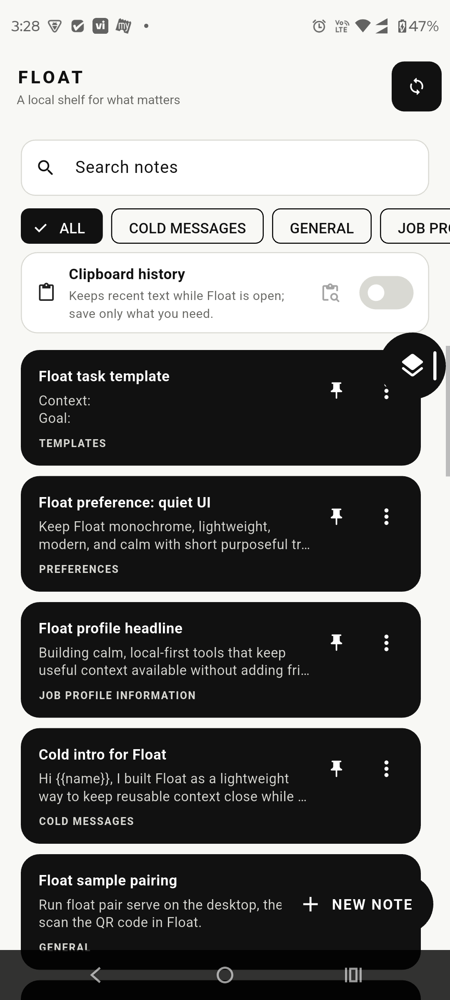

# Float

> Clipboard on steroids—without the gym membership.

Float is a lightweight, local-first shelf for the words you reuse. It keeps useful notes, templates, links, and recent pastes one tap away on Android, then gives your desktop CLI and AI tools the same private library through a local MCP server.

## Why Float exists

Float started with a very ordinary frustration: filling out forms meant hunting through clipboard history, scattered notes, old chats, and open tabs for the one paragraph or URL I needed to paste again. Float turns that scavenger hunt into a small, searchable shelf that stays close while you work.

No account. No hosted backend. No mystery sync. Pair your phone with your computer on a trusted local network and keep the useful bits moving between your devices.

## See it in action

<p align="center">
  
  
  
  
</p>

## What you get

- **A calm Android shelf** — groups, search, pins, pagination, and a monochromatic UI for notes that are meant to be reused.
- **A floating handle** — tap the always-available edge handle over another app to open pinned notes and copy one with a single tap.
- **A clipboard shelf** — opt in to keep recent text pastes locally, then save only the useful ones as normal notes.
- **A desktop companion** — the TypeScript CLI stores your notes locally, runs the paired-device agent, and exposes a local stdio MCP server.
- **Agent-ready context** — Codex, Claude Desktop, Cursor, and other MCP clients can search, create, update, and delete Float notes.
- **Private pairing** — QR code or an eight-digit code, with no accounts and no cloud dependency.

## Project layout

```text
app/       Flutter Android application
cli/       TypeScript CLI, local agent, and MCP server
packages/  Local Flutter overlay dependency
docs/      Public screenshots and project documentation
```

## Setup

### Fast path: ask an agent

Point a terminal-capable agent at [AGENT-SETUP.md](AGENT-SETUP.md). It checks
prerequisites, builds the CLI, registers the local MCP server, and can prepare
the Android app, pairing, and startup sync without cloud setup.

### Manual path

1. Build the desktop companion:

   ```powershell
   pnpm install
   pnpm --dir cli build
   ```

2. Run Android:

   ```powershell
   cd app
   flutter pub get
   flutter run
   ```

   For a real device, pass `--dart-define=FLOAT_AGENT_URL=http://YOUR_PC_WIFI_IP:8787`.

3. Pair once on the same trusted Wi-Fi:

   ```powershell
   node cli/dist/index.js pair serve
   ```

   Scan the QR in Float or enter the printed eight-digit code. Use
   `node cli/dist/index.js pair show` if an agent is already running.

4. Keep sync available after login (optional):

   ```powershell
   node cli/dist/index.js agent install
   ```

5. Add MCP using [MCP.md](MCP.md) or the agent runbook. The server command is:

   ```text
   node cli/dist/index.js mcp serve
   ```

The CLI stores data in `%USERPROFILE%\\.float\\snippets.json` by default. See
[MCP-AGENT-SETUP.md](MCP-AGENT-SETUP.md) for MCP-specific safety and tool
guidance, and [MCP.md](MCP.md) for client configuration examples.

## Clipboard shelf

Clipboard history is opt-in. While Float is open, it keeps the latest 20 text pastes in a separate “Latest pastes” modal. Tapping an item copies it again; tapping **+** saves it as a normal Float note. Clipboard entries are never silently turned into notes or synced unless you choose to save them. Android limits background clipboard access for ordinary apps, so continuous background history is intentionally out of scope.

## Release build

Build a distributable Android APK locally:

```powershell
cd app
flutter build apk --release
```

The artifact is written to `app/build/app/outputs/flutter-apk/app-release.apk`. GitHub releases are published from the CLI and include this APK as an asset.

## Privacy and diagnostics

Notes, clipboard entries, pairing credentials, and agent state stay on your devices. Pairing credentials expire after ten minutes. For troubleshooting, keep the agent terminal open and inspect `[float-agent]` events; Android pairing events are available with:

```powershell
adb logcat | Select-String FloatPair
```

## Validation

```powershell
pnpm --dir cli build
cd app
flutter test
flutter build apk --release
```

## License

Float is available under the [MIT License](LICENSE).
